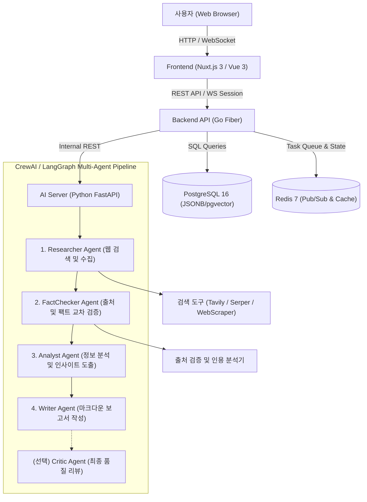

# ResearchForge 시스템 아키텍처 명세서 (Architecture)

## 1. 개요 및 계층 구조

ResearchForge는 AI 기반 멀티 에이전트 리서치 플랫폼으로, 사용자의 복잡한 리서치 질문을 4개의 특화된 AI 에이전트(Researcher, FactChecker, Analyst, Writer)가 유기적으로 협업하여 정보 수집, 신뢰성 검증, 심층 분석, 구조화된 보고서 작성을 수행합니다.

### 1.1 계층별 컴포넌트

---

## 2. 모듈별 세부 책임

### 2.1 Frontend (`frontend/`) - Nuxt 3
- **포트**: 3000
- **역할**:
  - 사용자 친화적인 리서치 질의 입력 및 옵션 설정 (깊이, 출처 최소 개수 등)
  - WebSocket 실시간 연결을 통한 에이전트별 진행 단계(타임라인) 시각화
  - 보고서 뷰어(Markdown 렌더링, 인용구 하이라이트 및 원본 링크 모달)
  - 과거 리서치 히스토리 및 북마크/내보내기 UI 제공

### 2.2 Backend (`backend/`) - Go Fiber
- **포트**: 8080
- **역할**:
  - JWT 기반 사용자 인증 및 프로젝트 관리
  - 리서치 요청 접수 및 Redis 큐를 통한 비동기 작업 관리
  - FastAPI AI 서버와의 REST 통신 제어 및 상태 동기화
  - 클라이언트 대상 WebSocket 실시간 상태/로그 브로드캐스팅
  - 데이터 영속성 관리(PostgreSQL 리포지토리 패턴)

### 2.3 AI Server (`ai-server/`) - Python FastAPI
- **포트**: 8000
- **역할**:
  - CrewAI / LangGraph 워크플로우 실행 엔진
  - 에이전트 프롬프트 및 도구(Tools) 통합 관리
  - Tavily / Serper API를 활용한 웹 검색 및 콘텐츠 추출
  - Pydantic v2 기반 스키마 유효성 검사 및 구조화된 결과 생성

---

## 3. 데이터 흐름 및 상태 머신

```mermaid
sequenceDiagram
    autonumber
    actor User as 사용자
    participant FE as Frontend (Nuxt 3)
    participant BE as Backend (Go Fiber)
    participant Redis as Redis Queue
    participant AI as AI Server (FastAPI)
    participant DB as PostgreSQL

    User->>FE: 리서치 요청 (주제, 옵션)
    FE->>BE: POST /api/research
    BE->>DB: 프로젝트 생성 (상태: pending)
    BE->>Redis: 리서치 태스크 큐 발행
    FE->>BE: WS /ws/research/:id 연결
    BE->>AI: POST /ai/crew/run
    BE->>DB: 상태 업데이트 (running)
    BE-->>FE: WS 에이전트 단계 전송 (Researcher 시작)
    
    AI->>AI: Researcher 에이전트 검색 수집
    AI-->>BE: 중간 로그 / 상태 콜백
    BE-->>FE: WS 진행률 업데이트
    
    AI->>AI: FactChecker 에이전트 검증
    AI->>AI: Analyst 에이전트 분석
    AI->>AI: Writer 에이전트 보고서 완성
    
    AI-->>BE: 최종 리포트 및 출처 반환
    BE->>DB: 보고서 및 에이전트 로그 저장 (completed)
    BE-->>FE: WS 최종 완료 신호 전송
    FE->>User: 완성된 보고서 및 출처 렌더링
```

---

## 4. 데이터베이스 엔티티 설계

1. **`users`**: 시스템 사용자 및 계정
2. **`research_projects`**: 리서치 프로젝트 메타데이터, 사용자 입력 쿼리, 옵션, 진행 상태 (`pending`, `running`, `completed`, `failed`)
3. **`agent_executions`**: 각 에이전트(Researcher, FactChecker 등)의 실행 이력, 입출력 페이로드, 시작/종료 시각
4. **`reports`**: 생성된 최종 Markdown 본문, 출처 리스트(JSONB), 메타데이터

---

## 5. 통신 프로토콜 명세

- **RESTful Endpoints**:
  - `POST /api/auth/register`, `POST /api/auth/login`
  - `POST /api/research` : 신규 리서치 발주
  - `GET /api/research` : 리서치 목록 조회
  - `GET /api/research/:id` : 리서치 상세 정보 및 결과 보고서 조회
  - `POST /api/research/:id/export` : 보고서 Markdown/PDF 내보내기
- **WebSocket Protocol**:
  - `ws://host:8080/ws/research/:id`
  - 이벤트 타입: `STEP_START`, `STEP_PROGRESS`, `STEP_COMPLETE`, `PROJECT_DONE`, `ERROR`
